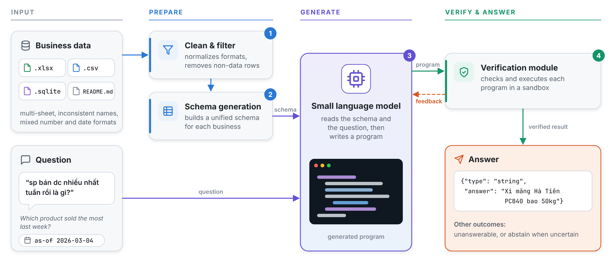
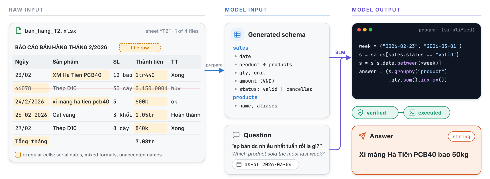
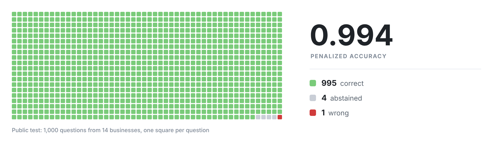

# ZAIC 2026 — DataMate Track

Verified program generation for question answering over messy Vietnamese business data

## Problem

The DataMate track of the [Zalo AI Challenge 2026](https://challenge.zalo.ai/portal/datamate) calls for an agent that
answers everyday Vietnamese questions directly from the records of small businesses, stored as Excel workbooks, CSV
files and SQLite databases. For each question, the agent must return an exact, typed answer, recognize when the data
cannot answer it, or abstain. Four factors make the task difficult:

- **Messy records.** Title rows above the header, summary rows, Excel serial dates, amounts written as `1tr440` or
  `600k`, and the same product spelled in different ways.
- **Informal questions.** Abbreviations, missing diacritics and relative time expressions such as "last week", which
  must be interpreted against a reference date and a business rulebook.
- **Penalized scoring.** A correct answer earns +1, an abstention 0 and a wrong answer −1 (penalized accuracy, PA).
- **Limited resources.** Inference runs offline, with at most 15B parameters across all models, and must finish within
  6 hours on two RTX 5090 GPUs.

## Method

We formulate each question as a program-generation task. The raw files of a business are first cleaned and described
by a unified schema. A small language model (SLM) then reads this schema together with the question and writes a
program that computes the answer. Each program is verified and executed in a sandbox before its result is accepted.

  <picture>
    <source media="(prefers-color-scheme: dark)" srcset="assets/pipeline-dark.png">
    
  </picture>

| Stage | Function |
|---|---|
| ① Clean & filter | Normalizes headers, numbers and dates, and removes non-data rows such as report titles and totals. |
| ② Schema generation | Maps the tables of each business onto a unified schema. |
| ③ Small language model | Reads the schema and the question, and writes a program that computes the answer. |
| ④ Verification module | Checks each program and executes it in a sandbox. Programs that fail are returned to the model with feedback; when confidence is low, the system abstains. |

### Example

  <picture>
    <source media="(prefers-color-scheme: dark)" srcset="assets/example-dark.png">
    
  </picture>

Here the answer depends on details that are easy to miss in the raw sheet: the same product is recorded under two
spellings, one date is stored as an Excel serial number, the sheet ends with a summary row, and the largest order in
the sheet was cancelled and therefore does not count.

## Advantages

- **Reliable.** Every answer is computed by an executed program that has gone through verification, and the system
  abstains rather than guessing when its confidence is low.
- **Robust to messy data.** Cleaning and schema generation give the model a consistent view of each business, so the
  generated programs work on clean, uniform tables.
- **Compact and efficient.** A single small language model, well within the 15B-parameter budget, answers all 1,000
  public-test questions end to end in under 20 minutes on four NVIDIA L4 GPUs.
- **Interpretable.** Each answer can be traced to the program that produced it and to its execution output.

## Results

  <picture>
    <source media="(prefers-color-scheme: dark)" srcset="assets/results-dark.png">
    
  </picture>

On the public test (1,000 questions from 14 businesses), the system achieves a penalized accuracy of **0.994**, with
995 correct answers, 4 abstentions and a single wrong answer. Repeated runs score between 0.993 and 0.994.

## Release

Code and method details will be released after 20 November 2026.
